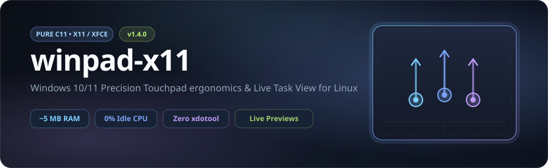
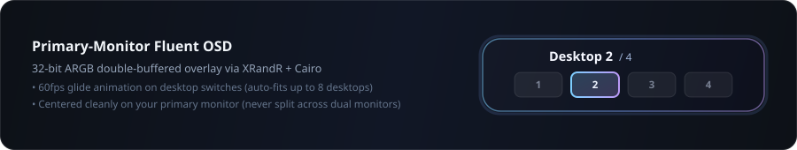

<div align="center">



<br/><br/>

[](https://github.com/mudmini009/winpad-x11/actions/workflows/ci.yml)
[](src/)
[](#requirements)
[](#measured-footprint)
[](#measured-footprint)
[](LICENSE)

<h3>Genuine Windows 10/11 Precision Touchpad ergonomics &amp; Live Task View for Linux X11 / XFCE — written in pure C with zero runtime bloat.</h3>

[Quick Install](#-quick-install) &nbsp;•&nbsp; [Gesture Map](#-gesture-map) &nbsp;•&nbsp; [Windows Parity](#-windows-1011-precision-parity) &nbsp;•&nbsp; [Task View & OSD](#-live-task-view--fluent-osd) &nbsp;•&nbsp; [Configuration](#%EF%B8%8F-configuration) &nbsp;•&nbsp; [Changelog](CHANGELOG.md)

</div>

---

<table>
<tr>
<td width="50%" valign="top">

### ⚡ Pure C, Zero Bloat
- **`43 KB` daemon** (~4.9 MB RSS, **0.0% idle CPU**)
- Zero `xdotool`, Python, or Ruby runtime dependencies
- Direct kernel `evdev` reader works even on older X11 `libinput`
- Instant `udev` `uaccess` permission — **no reboot or logout**

</td>
<td width="50%" valign="top">

### 🎯 True Windows 11 Ergonomics
- Exact **3-state Up/Down cycle** (Task View ↔ Windows ↔ Desktop)
- **3-finger Tap → `Super`** (Search / Whisker Menu, no middle-click paste)
- **4-finger Tap → Media Play/Pause** *(or Notifications / Task View / custom)*
- **Double-tap Drag Edge Auto-Slide** at 60fps when hitting borders
- **1-swipe = 1-desktop (`4F`)** + **end-clamped `Alt+Tab` (`3F`)**

</td>
</tr>
</table>

---

## ✨ Why `winpad-x11`?

Most Linux X11 gesture tools either run heavy scripting runtimes (Ruby/Python), spawn `xdotool` child processes on every swipe, or break on Ubuntu/Xubuntu (`xserver-xorg-input-libinput < 1.3` ignores 3/4-finger gestures over XInput2, and `apt install touchegg` on Ubuntu 22.04 pulls an outdated `1.1.1` package).

**`winpad-x11` handles everything natively in two tiny compiled C binaries:**

| Feature | `winpad-x11` | Touchégg v2 | `libinput-gestures` | Fusuma | `xgestured` / `gebaar` |
|---|:---:|:---:|:---:|:---:|:---:|
| **Stack** | **Pure C (`evdev` + `X11`/`XTest`)** | C++ daemon + client | Python + pipe | Ruby gem | C / C++ daemon |
| **Runtime deps** | **None** | PPA / pugixml / GTK | `libinput-tools`, `xdotool` | Ruby, `libinput-tools`, `xdotool` | `libinput-dev`, `xdotool` |
| **Windows 3-state Up/Down cycle** | **Yes** | No | No | No | No |
| **3-finger Tap → Search (`Super`)** | **Yes** (auto-mutes Middle Click) | Partial | No | No | No |
| **4-finger Tap (Media / Notifications)** | **Yes** (`play_pause` / `notifications` / custom) | Partial | No | No | No |
| **Double-tap Drag Edge Auto-Slide** | **Yes** (60fps edge glide on drag) | No | No | No | No |
| **Interactive `Alt+Tab` scrubbing** | **Yes** (holds `Alt`, clamped at ends) | Partial | No | No | No |
| **1-swipe = 1-desktop (`4F`)** | **Yes** (Windows 11 default + Fluent OSD) | Manual | Manual | Manual | Manual |
| **Multi-language XKB layout safe** | **Yes** (`grp:alt_shift_toggle` safe) | No | No | No | No |
| **2-finger Back/Forward flick** | **Yes** (app-aware via `WM_CLASS`) | No | No | No | No |
| **Built-in Live Task View UI** | **Yes** (`XComposite` previews) | No | No | No | No |
| **Instant permission without logout** | **Yes** (`udev` `uaccess` rule) | Root service | `input` group + relogin | `input` group + relogin | `input` group + relogin |

---

## 🎯 Gesture Map

<div align="center">

</div>

### Exact Windows 10/11 3-State Vertical Cycle

```text
  [ Task View (Live Previews) ]  <─── Up / Down ───>  [ Normal Windows ]  <─── Down / Up ───>  [ Show Desktop ]
```

- **Normal windows → Swipe Down:** Minimizes all windows (**Show Desktop**)
- **Show Desktop → Swipe Up:** **Restores your open windows** (does not jump into Task View)
- **Normal windows → Swipe Up:** Opens **Task View**
- **Task View open → Swipe Down:** Closes Task View back to your windows

<details>
<summary><strong>Smart responsiveness &amp; anti-misfire engineering</strong></summary>

- **Double-tap & Click-drag Edge Auto-Slide:** When dragging a window, file, or text selection and your finger reaches the outer `6 mm` border/corner of the touchpad, `winpad-gestures` smoothly glides the pointer at 60fps (`Button1` held, zero sticky drop lag) until you pull inward or lift your finger (`edge_drag_slide = true`).
- **Windows-style 3-finger Tap → `Super` (Search / Whisker Menu):** A quick 3-finger tap (`<= 260 ms`, `<= 3.5 mm` travel) presses `Super_L` to open Search / Whisker Menu on Xubuntu, automatically muting touchpad Middle Click (`Button 2`) while active so it never accidentally pastes or closes tabs (`three_finger_tap = off` restores Linux Middle Click).
- **Customizable 4-finger Tap:** A quick 4-finger tap (`<= 260 ms`, `<= 3.5 mm` travel, zero mouse-button conflict) triggers **Media Play/Pause (`XF86AudioPlay`)** by default on Xubuntu, or can be switched in config to `notifications` (`xfce4-notifyd-config`), `taskview`, `show_desktop`, `super`, `off`, or any custom command (`four_finger_tap_cmd`).
- **Fast-landing merge & 45 ms bounce hysteresis:** Preserves rapid initial swipe momentum during multi-finger landing (`< 55 ms`), with a `22 ms` 3-vs-4 settle window, `45 ms` downward-bounce hysteresis, and `4 -> 3` liftoff lock so swipes feel instantaneous while staying misfire-proof.
- **Boundary-clamped 3-finger `Alt+Tab` scrubbing:** Slide across the touchpad to scrub smoothly across open windows while holding `Alt`—**stopping cleanly at the first and last window** (Windows 10/11 style, no wraparound loop), even if starting from the desktop or Show Desktop.
- **Windows-authentic 4-finger Desktop switch (`1 swipe = 1 desktop`):** Each 4-finger swipe Left/Right switches **one** Virtual Desktop cleanly with a 60fps time-compensated **Primary-Monitor Fluent ARGB OSD** via XRandR + Cairo (or set `four_finger_scrub = true` in config for continuous multi-desktop scrubbing).
- **Task View aware navigation:** When Task View is open, 3-finger Left/Right scrubs window cards cleanly (clamped at first & last card, no looping) and 4-finger Left/Right switches desktops live.
- **Terminal-safe 2-finger Back/Forward flick:** Checks active window `WM_CLASS` via X11—sends `XF86Back`/`XF86Forward` to browsers & file managers, `Alt+Left`/`Alt+Right` to IDEs, and stays silent in terminals.
- **Scroll lock & XKB protection:** Vertical 2-finger scrolling (`> 5.5 mm`) locks out horizontal Back/Forward flicks, and `XkbLockGroup` preserves multi-language layouts (e.g. `grp:alt_shift_toggle`) during `Alt+Shift+Tab`.

</details>

---

## ⚖️ Windows 10/11 Precision Parity

| Fingers | Gesture | Windows 11 Precision Default | `winpad-x11` Behavior | Match |
|:---:|---|---|---|:---:|
| **1F** | Move, tap, tap-drag, click | Cursor, left-click, drag | Native via `libinput` (`40-libinput.conf`) | ✅ Exact |
| **1F** | Double-tap & drag at edge/corner | Continues sliding until lifted | 60fps Edge Drag Auto-Slide (`edge_drag_slide = true`) | ✅ Exact |
| **2F** | Tap | Right-click | `ClickMethod=clickfinger` + `TappingButtonMap=lrm` | ✅ Exact |
| **2F** | Scroll Up/Down/Left/Right | Natural scroll | `NaturalScrolling=true` + `HorizontalScrolling=true` | ✅ Exact |
| **2F** | Quick horizontal flick | Browser Back / Forward | `XF86Back`/`Forward` + IDE `Alt+←/→` (terminal-safe) | ✅ Exact |
| **2F** | Pinch In / Out | App zoom | Handled by apps supporting `libinput` XI2.4 gestures | ℹ️ App-dependent |
| **3F** | Tap | Windows Search | Sends `Super_L` (Whisker Menu / Search; `off` restores Middle Click) | ✅ Exact |
| **3F** | Swipe Up / Down | Task View ↔ Windows ↔ Desktop | Exact 3-state cycle (`winpad-taskview` + `_NET_SHOWING_DESKTOP`) | ✅ Exact |
| **3F** | Swipe Left / Right | Interactive `Alt+Tab` (clamped ends) | Holds `Alt`, scrubs `Tab`/`Shift+Tab`, **stops at ends** | ✅ Exact |
| **4F** | Tap | Notification Center | `play_pause` (`XF86AudioPlay` default) or `notifications` (`xfce4-notifyd-config`) / custom | ⚙️ Configurable |
| **4F** | Swipe Left / Right | 1 desktop per swipe (Right = next) | 1 desktop per swipe (`workspace_direct`) + Fluent OSD | ✅ Exact |
| **4F** | Swipe Up / Down | Task View ↔ Windows ↔ Desktop | Same exact 3-state cycle | ✅ Exact |

---

## 🪟 Live Task View & Fluent OSD

Swipe up with **3 or 4 fingers** to open **`winpad-taskview`** — featuring **real-time `XComposite` window thumbnails**, a **luminous Fluent selection aura & top accent bar**, an **`Active` window pill**, a **Virtual Desktops dock along the bottom** (with window indicator dots and click-to-switch), an **All Desktops** toggle, **instant type-to-filter search**, **cached ambient backdrop rendering**, and **0 MB idle RAM**.

<div align="center">

<br/><br/>

</div>

<details>
<summary><strong>Task View keyboard, mouse &amp; gesture controls</strong></summary>

| Input | Action |
|---|---|
| **Left-click card** / **`Enter`** | Switch to window (auto-switches desktop & unminimizes if needed) |
| **3-finger Left/Right** / **`←` `→`** | Select previous / next card (clamped cleanly at first & last card) |
| **`Home` / `End`** | Jump to first / last visible window card |
| **Type anywhere** / **`Backspace`** | Instant case-insensitive filter by window title or app name |
| **Middle-click card** / **`×` button** | Close window cleanly and update Task View |
| **`Ctrl + ←` / `→`** or **4-finger Left/Right** | Preview / switch Virtual Desktops inside Task View |
| **`All Desktops`** pill | Toggle between active desktop and all open windows |
| **`Esc`** / **Click backdrop** / **3F/4F Down** | Clear filter (1st `Esc`) or exit Task View |

</details>

---

## ⚡ Measured Footprint

Baseline measured on Ubuntu 22.04 / Xubuntu (`x86_64`, compiled with `gcc -O2 -flto` and stripped):

| Component | Binary Size | Memory (RSS) | Idle CPU |
|---|---:|---:|---:|
| `winpad-gestures` (background daemon) | **43 KB** | **~4.9 MB (`5052 KB`)** | **0.0%** (`poll()`) |
| `winpad-taskview` (on-demand Task View) | **47 KB** | **0 MB idle** (exits on close) | **0.0%** |

---

## 📋 Requirements

- Linux **X11** desktop session (`xfwm4`, Openbox, i3, MATE, etc. — EWMH compatible) using **`libinput`** (`xserver-xorg-input-libinput`)
- Verified on **Ubuntu / Xubuntu 22.04 & 24.04** (`libwnck < 43` and `libwnck >= 43`)
- Build dependencies (only needed once during compilation):
  ```bash
  sudo apt update && sudo apt install -y gcc make pkg-config libx11-dev libxtst-dev libxrandr-dev libxrender-dev libcairo2-dev libgtk-3-dev libwnck-3-dev libxcomposite-dev
  ```
  *(Note: `libxcomposite-dev` enables live window thumbnails; [`Makefile`](Makefile) automatically falls back to icon-card mode if `xcomposite` is absent.)*

---

## 🚀 Quick Install

```bash
git clone https://github.com/mudmini009/winpad-x11.git
cd winpad-x11
./scripts/setup.sh
```

> **Update anytime:** `git pull && ./scripts/setup.sh` *(preserves your existing `~/.config/winpad-gestures.conf`)*
>
> **Uninstall anytime:** `make uninstall`

<details>
<summary><strong>What <code>scripts/setup.sh</code> configures for you</strong></summary>

1. Compiles (`-O2 -flto -Wall -Wextra -Werror`) & strips `winpad-gestures` and `winpad-taskview` into `~/.local/bin/`, and installs the XFCE autostart entry (`~/.config/autostart/winpad-gestures.desktop`).
2. Installs `/etc/udev/rules.d/65-touchpad-uaccess.rules` (`TAG+="uaccess"` on `ID_INPUT_TOUCHPAD==1`) and triggers `udevadm` so the active user gets read access immediately **with no reboot or logout**.
3. Writes clean Precision Touchpad defaults in `/etc/X11/xorg.conf.d/40-libinput.conf` and applies XFCE defaults (tap-to-click, `clickfinger`, natural scrolling, 4 workspaces, `cycle_minimized`, disables `mousewheel_rollup`).
4. Auto-detects your touchpad (reads `ABS_MT_POSITION_X/Y` physical mm resolution) and launches `winpad-gestures` right away.

</details>

---

## ⚙️ Configuration

<details>
<summary><strong>Customize thresholds, directions, edge slide, or 3-finger tap</strong></summary>

Edit `~/.config/winpad-gestures.conf` and reload live without restarting:

```bash
killall -HUP winpad-gestures
```

```ini
# Device ("auto" scans /dev/input/event* for any multitouch touchpad)
device = auto

# 1-finger Double-Tap / Click-Drag Edge Auto-Slide (keeps sliding when hitting touchpad edges)
edge_drag_slide = true
edge_drag_margin_mm = 6.0
edge_drag_speed = 460

# 2-finger horizontal flick: natural (right=Back, left=Forward) | arrow | off
two_finger_swipe = natural
two_finger_swipe_min_mm = 14
two_finger_swipe_max_ms = 360

# 3-finger horizontal swipe: alt_tab_scrub | alt_tab_once | off
three_finger_horiz = alt_tab_scrub
three_finger_direction = direct
three_finger_thresh_mm = 6.5
three_finger_step_mm = 11.5
three_finger_v_thresh_mm = 7.5

# 3-finger tap: super (Windows 11 Search / Whisker Menu) | off (Linux Middle Click)
three_finger_tap = super
# three_finger_tap_cmd = xfce4-popup-whiskermenu

# 4-finger horizontal swipe: workspace_direct (Windows 11 default: 1 swipe = 1 desktop) | workspace_natural | alt_tab | off
four_finger_horiz = workspace_direct
four_finger_scrub = false
four_finger_thresh_mm = 7.5
four_finger_step_mm = 15.0

# 4-finger tap: play_pause (XF86AudioPlay) | notifications (xfce4-notifyd-config) | taskview | show_desktop | super | off
four_finger_tap = play_pause
# four_finger_tap_cmd = xfce4-notifyd-config

# 3/4-finger Swipe Up command (can also swap for xfdashboard or rofi -show window)
taskview_cmd = ~/.local/bin/winpad-taskview
```

</details>

<details>
<summary><strong>Architecture &amp; how it works</strong></summary>

- **Direct kernel `evdev` reader (`src/winpad-gestures.c`):** Reads `ABS_MT_SLOT` / `ABS_MT_TRACKING_ID` / `ABS_MT_POSITION_X/Y` directly from `/dev/input/event*` using `poll()` (0% idle CPU) and scales deltas using the hardware's physical `resolution` (counts/mm). Because it reads `evdev` directly, 3/4-finger gestures work even on older `xserver-xorg-input-libinput` versions.
- **Zero-spawn X11/EWMH actions:** Emits `Alt+Tab`, `Super_L`, `XF86Back`/`Forward`, and navigation keys directly via `XTest`, queries `_NET_CLIENT_LIST` / `_NET_WM_WINDOW_TYPE` / `_NET_WM_STATE` for boundary-clamped `Alt+Tab`, switches workspaces via `_NET_CURRENT_DESKTOP`, drives 60fps edge-drag auto-sliding via `XTestFakeRelativeMotionEvent` only while dragging inside the border zone, and draws the 32-bit ARGB Fluent OSD using Cairo + XRandR.
- **On-demand `winpad-taskview` (`src/winpad-taskview.c`):** Spawned only when Task View opens (`SIGUSR1` updates workspace on live desktop switch, `SIGTERM` / re-invocation toggles off), captures `XComposite` backing pixmaps before mapping, caches the backdrop surface, and exits cleanly when a window is chosen (`0 MB` idle RAM).

</details>

<details>
<summary><strong>Troubleshooting &amp; diagnostics</strong></summary>

- **3-finger tap opens nothing on older XFCE configs:** Ensure `Super_L` is bound to `xfce4-popup-whiskermenu` in *Settings → Keyboard → Application Shortcuts*, or set `three_finger_tap_cmd = xfce4-popup-whiskermenu` in `~/.config/winpad-gestures.conf`.
- **Want sticky tap-drag lock across finger lifts too?** `xinput set-prop "<Your Touchpad Name>" "libinput Tapping Drag Lock Enabled" 1` (optional; `edge_drag_slide` handles edge/corner sliding without sticky drop lag).
- **Verify touchpad detection & permissions:**
  ```bash
  ~/.local/bin/winpad-gestures --check
  ```
- **Preview Primary-Monitor Fluent OSD:**
  ```bash
  ~/.local/bin/winpad-gestures --test-osd
  ```
- **Run with live debug output:**
  ```bash
  pkill -x winpad-gestures && ~/.local/bin/winpad-gestures --debug
  ```
- **Ensure legacy `synaptics` Xorg driver isn't installed** (it conflicts with `libinput`):
  ```bash
  sudo apt remove xserver-xorg-input-synaptics
  ```
- **Older X11 apps dropping first scroll tick on direction reversal (`xserver-xorg-input-libinput 1.2.x`):**
  ```bash
  xinput set-prop "<Your Touchpad Name>" "libinput High Resolution Wheel Scroll Enabled" 0
  ```

</details>

---

<div align="center">

**[Changelog](CHANGELOG.md)** &nbsp;•&nbsp; **[Report a Bug](.github/ISSUE_TEMPLATE/bug_report.md)** &nbsp;•&nbsp; **[Request a Feature](.github/ISSUE_TEMPLATE/feature_request.md)** &nbsp;•&nbsp; **[MIT License](LICENSE)** 

<sub>If <code>winpad-x11</code> made your Linux touchpad feel like home, consider giving it a ⭐ on GitHub!</sub>

</div>
