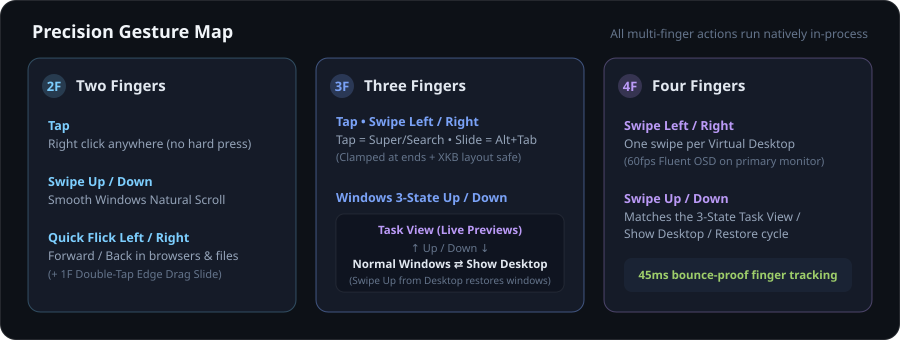
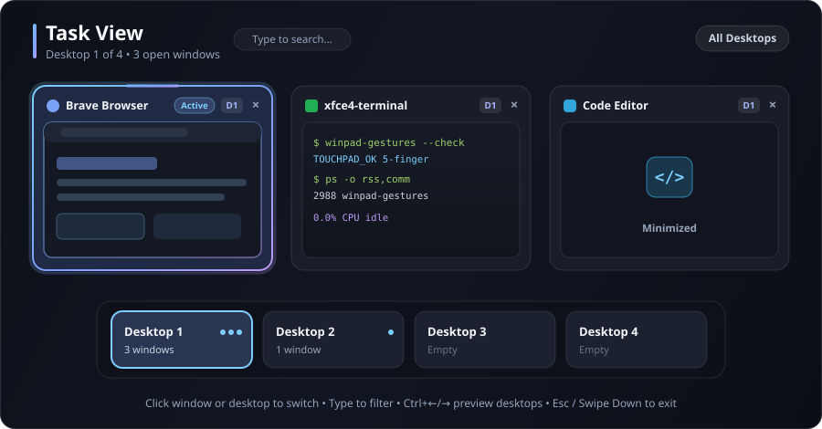

<div align="center">


<br/><br/>

[](src/)
[](#requirements)
[](#measured-footprint)
[](#measured-footprint)
[](LICENSE)

**Bring genuine Windows 10/11 Precision Touchpad ergonomics to Linux X11 & XFCE — in pure C, with zero runtime bloat.**

[Quick Install](#-quick-install) • [Gesture Map](#-gesture-map) • [Task View](#-live-task-view) • [Why winpad-x11?](#-why-winpad-x11) • [Configuration](#-configuration)

</div>

---

## ✨ What Makes `winpad-x11` Different?

Most Linux X11 gesture tools either run heavy scripting runtimes (Ruby/Python), spawn `xdotool` child processes on every swipe, or fail on Ubuntu/Xubuntu (`xserver-xorg-input-libinput < 1.3` doesn't forward 3/4-finger gestures over XInput2, and `apt install touchegg` on Ubuntu 22.04 pulls an outdated `1.1.1` package that ignores `libinput`).

**`winpad-x11` solves all of it natively in two tiny compiled binaries:**

| Feature | `winpad-x11` | Touchégg v2 | `libinput-gestures` | Fusuma | `xgestured` / `gebaar` |
|---|:---:|:---:|:---:|:---:|:---:|
| **Stack** | **Pure C (`evdev` + `X11`/`XTest`)** | C++ daemon + client | Python + pipe | Ruby gem | C / C++ daemon |
| **Runtime deps** | **None** | PPA / pugixml / GTK | `libinput-tools`, `xdotool` | Ruby, `libinput-tools`, `xdotool` | `libinput-dev`, `xdotool` |
| **Windows 3-state Up/Down cycle** | **Yes** | No | No | No | No |
| **Interactive `Alt+Tab` scrubbing** | **Yes** (holds `Alt` while sliding) | Partial | No | No | No |
| **Multi-language XKB layout safe** | **Yes** (`grp:alt_shift_toggle` safe) | No | No | No | No |
| **2-finger Back/Forward flick** | **Yes** (app-aware via `WM_CLASS`) | No | No | No | No |
| **Built-in Live Task View UI** | **Yes** (`XComposite` previews) | No | No | No | No |
| **Instant permission without logout** | **Yes** (`udev` `uaccess` rule) | Root service | Requires `input` group + relogin | Requires `input` group + relogin | Requires `input` group + relogin |

---

## 🎯 Gesture Map

<div align="center">

</div>

### Exact Windows 10/11 3-State Vertical Cycle
Unlike simple toggle scripts, 3-finger & 4-finger vertical swipes follow the exact Windows Precision Touchpad state machine:

```text
  [ Task View (Live Previews) ]  <─── Up / Down ───>  [ Normal Windows ]  <─── Down / Up ───>  [ Show Desktop ]
```

- **Normal windows → Swipe Down:** Minimizes all windows (**Show Desktop**)
- **Show Desktop → Swipe Up:** **Restores your open windows** (does not jump into Task View)
- **Normal windows → Swipe Up:** Opens **Task View**
- **Task View open → Swipe Down:** Closes Task View back to your windows

### Smart Responsiveness & Anti-Misfire Guards
- **Fast-landing merge & 45 ms bounce hysteresis:** Preserves rapid initial swipe momentum during multi-finger landing (`< 55 ms`), with a `20 ms` 3-vs-4 settle window and `45 ms` downward-bounce hysteresis so swipes feel instantaneous while staying misfire-proof.
- **Continuous 3-finger & 4-finger scrubbing:** Slide once across the touchpad to scrub smoothly across **all `Alt+Tab` windows** (`3F`) or **all Virtual Desktops `D1 → D4`** (`4F`) in a single motion—complete with a 60fps sliding-glow **Primary-Monitor Fluent ARGB OSD** via XRandR + Cairo.
- **Task View aware navigation:** When Task View is open, 3-finger Left/Right scrubs window cards inside Task View and 4-finger Left/Right scrubs desktops live.
- **Terminal-safe 2-finger Back/Forward:** Checks active window `WM_CLASS` via X11—sends `XF86Back`/`XF86Forward` to browsers & file managers, `Alt+Left`/`Alt+Right` to IDEs, and stays silent in terminals.
- **Scroll lock protection:** Vertical 2-finger scrolling locks out horizontal Back/Forward flicks (`> 5.5 mm` vertical motion), preventing accidental navigation while scrolling.
- **XKB layout protection:** Saves and restores active XKB group via `XkbLockGroup` so `Alt+Shift+Tab` never accidentally flips multi-language layouts (e.g. `grp:alt_shift_toggle`).

---

## 🪟 Live Task View

Swipe up with **3 or 4 fingers** to open **`winpad-taskview`** — matching Windows 11's layout with **real-time `XComposite` window thumbnails** centered for the active desktop, a **Virtual Desktops dock along the bottom** (with window counts and click-to-switch), an **All Desktops** toggle, **type-to-filter search**, and **0 MB idle RAM**.

<div align="center">

</div>

---

## ⚡ Measured Footprint

Observed on Ubuntu 22.04 / Xubuntu (`x86_64`, compiled with `gcc -O2 -flto` and stripped):

| Component | Binary Size | Memory (RSS) | Idle CPU |
|---|---:|---:|---:|
| `winpad-gestures` (background daemon) | **43 KB** | **~4.4 MB (`4520 KB`)** | **0.0%** (`poll()`) |
| `winpad-taskview` (on-demand Task View) | **47 KB** | **0 MB idle** (exits on close) | **0.0%** |

---

## 📋 Requirements

- Linux **X11** desktop session (`xfwm4`, Openbox, i3, MATE, etc. — EWMH compatible) using **`libinput`** (`xserver-xorg-input-libinput`)
- Build dependencies (only needed once during compilation):
  ```bash
  sudo apt update && sudo apt install -y gcc pkg-config libx11-dev libxtst-dev libxrandr-dev libxrender-dev libcairo2-dev libgtk-3-dev libwnck-3-dev libxcomposite-dev
  ```
  *(Note: `libxcomposite-dev` enables live window thumbnails; `Makefile` automatically falls back to icon-card mode if `xcomposite` is absent.)*

---

## 🚀 Quick Install

```bash
git clone https://github.com/mudmini009/winpad-x11.git
cd winpad-x11
./scripts/setup.sh
```

**What `scripts/setup.sh` does:**
1. Compiles (`-O2 -flto`) & strips `winpad-gestures` and `winpad-taskview` into `~/.local/bin/`, and installs the XFCE autostart entry (`~/.config/autostart/winpad-gestures.desktop`).
2. Installs `/etc/udev/rules.d/65-touchpad-uaccess.rules` (`TAG+="uaccess"` on `ID_INPUT_TOUCHPAD==1`) and triggers `udevadm` so the active user gets read access immediately **with no reboot or logout**.
3. Writes clean Precision Touchpad defaults in `/etc/X11/xorg.conf.d/40-libinput.conf` and applies XFCE defaults (tap-to-click, `clickfinger`, natural scrolling, 4 workspaces, disables `mousewheel_rollup`).
4. Auto-detects your touchpad (reads `ABS_MT_POSITION_X/Y` physical mm resolution) and launches `winpad-gestures` right away.

---

## ⚙️ Configuration

<details>
<summary><strong>Customize thresholds, directions, or Task View command</strong></summary>

Edit `~/.config/winpad-gestures.conf` and reload live without restarting:

```bash
killall -HUP winpad-gestures
```

```ini
# Device ("auto" scans /dev/input/event* for any multitouch touchpad)
device = auto

# 2-finger horizontal flick: natural (right=Back, left=Forward) | arrow | off
two_finger_swipe = natural
two_finger_swipe_min_mm = 14
two_finger_swipe_max_ms = 360

# 3-finger horizontal swipe: alt_tab_scrub | alt_tab_once | off
three_finger_horiz = alt_tab_scrub
three_finger_direction = direct
three_finger_thresh_mm = 6.5
three_finger_step_mm = 11.5
three_finger_v_thresh_mm = 7.5

# 4-finger horizontal swipe: workspace_direct (Windows 11 default) | workspace_natural | alt_tab | off
four_finger_horiz = workspace_direct
four_finger_thresh_mm = 7.5
four_finger_step_mm = 15.0

# 3/4-finger Swipe Up command (can also swap for xfdashboard or rofi -show window)
taskview_cmd = ~/.local/bin/winpad-taskview
```

</details>

<details>
<summary><strong>Troubleshooting & Diagnostics</strong></summary>

- **Verify touchpad detection & permissions:**
  ```bash
  ~/.local/bin/winpad-gestures --check
  ```
- **Run with live debug output:**
  ```bash
  pkill -x winpad-gestures && ~/.local/bin/winpad-gestures --debug
  ```
- **Ensure legacy `synaptics` Xorg driver isn't installed** (it conflicts with `libinput`):
  ```bash
  sudo apt remove xserver-xorg-input-synaptics
  ```
- **Older X11 apps dropping first scroll tick on direction reversal (`xserver-xorg-input-libinput 1.2.x`):**
  ```bash
  xinput set-prop "<Your Touchpad Name>" "libinput High Resolution Wheel Scroll Enabled" 0
  ```

</details>

---

## 📄 License

MIT License — see [LICENSE](LICENSE).
